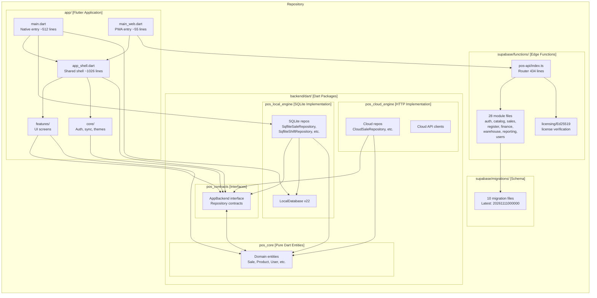
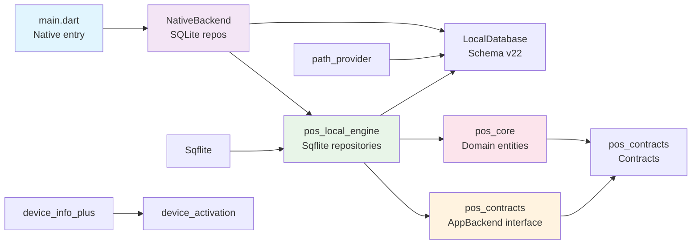
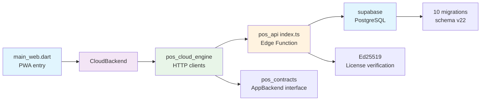
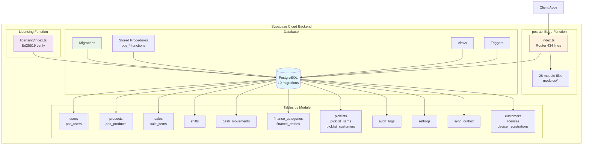
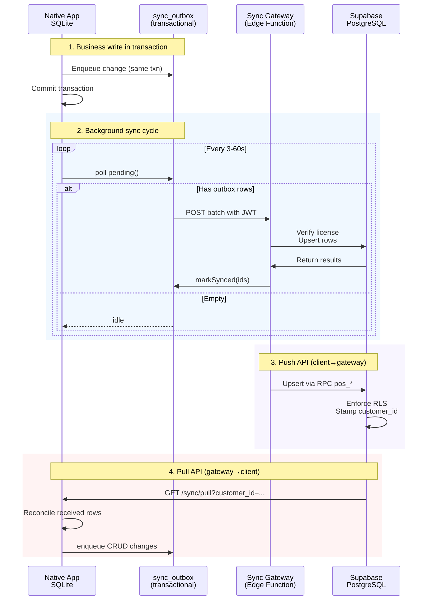
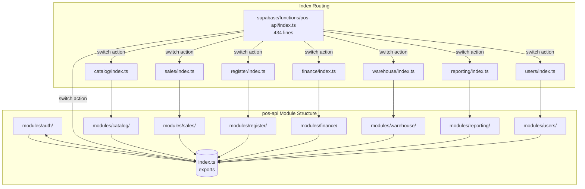
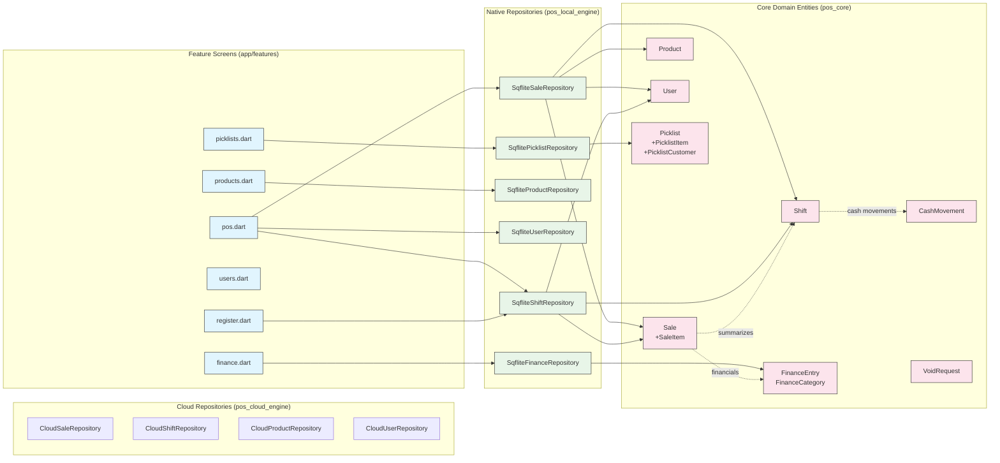
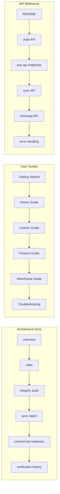

# Final Architecture Overview — Wholesale POS

**Date:** 2026-11-21
**Version:** Stage 10 completion (FINAL ARCHITECTURE ENFORCEMENT, VERIFICATION AND DOCUMENTATION)
**Scope:** Unified view of the entire Wholesale POS architecture across all repositories and platforms.

---

## 1. Full Repository Architecture



### Key Repository Modules

| Module | Purpose | Location |
| -------- | --------- | ---------- |
| **pos_core** | Pure Dart domain entities | `backend/dart/pos_core/` |
| **pos_contracts** | Abstract interfaces and contracts | `backend/dart/pos_contracts/` |
| **pos_local_engine** | SQLite implementations | `backend/dart/pos_local_engine/` |
| **pos_cloud_engine** | HTTP clients and cloud repos | `backend/dart/pos_cloud_engine/` |
| **pos-api** | Supabase Edge Functions | `supabase/functions/pos-api/` |
| **licensing** | Ed25519 license verification | `supabase/functions/licensing/` |

---

## 2. Native App Dependency Flow



### Native Entry Point Flow

1. `main.dart` (~512 lines) initializes:
   - `LocalDatabase` (SQLite, schema v22)
   - Repository implementations from `pos_local_engine`
   - `NativeBackend` wrapping repositories
   - `WholesalePosApp` with `PosRoot` shell

2. **Key imports:** `sqflite`, `pos_local_engine`, `pos_contracts`, `app_shell.dart`

3. **No HTTP dependencies** — fully offline capable

---

## 3. Web App Dependency Flow



### Web Entry Point Flow

1. `main_web.dart` (~55 lines) initializes:
   - `CloudApiClient` with activation code
   - `CloudBackend` wrapping HTTP repos
   - `PosRoot` shell with `WebActivationGate`

2. **Key imports:** `pos_cloud_engine`, `pos_contracts`, `app_shell.dart`

3. **All data access** goes through `pos-api` Edge Function via REST

---

## 4. Local Persistence (SQLite)

```mermaid
erDiagram
    %% Table definitions with primary keys and relationships
    USERS {
        TEXT id PK "UUID"
        TEXT username UK "PBKDF2 hash"
        TEXT password_hash 
        TEXT salt 
        TEXT role 
        INTEGER is_active 
        INTEGER is_demo 
        TEXT permissions 
    }
    
    PRODUCTS {
        TEXT id PK 
        TEXT code UK 
        TEXT name 
        INTEGER selling_price_minor_units 
        TEXT category 
    }
    
    DEVICES {
        TEXT id PK 
        TEXT name 
        TEXT platform 
        TEXT license_key 
        TEXT last_sync_at 
    }
    
    SHIFTS {
        TEXT id PK 
        TEXT cashier_id FK "users.id"
        INTEGER opening_cash_minor_units 
        INTEGER closing_cash_minor_units 
        INTEGER expected_cash_minor_units 
        TEXT status 
    }
    
    CASH_MOVEMENTS {
        TEXT id PK 
        TEXT shift_id FK "shifts.id"
        TEXT user_id FK "users.id"
        TEXT type 
        INTEGER amount_minor_units 
    }
    
    SALES {
        TEXT id PK 
        TEXT receipt_number UK 
        TEXT cashier_id FK "users.id"
        TEXT device_id FK "devices.id"
        TEXT shift_id FK "shifts.id"
        TEXT customer_name 
        TEXT payment_method 
        INTEGER subtotal_minor_units 
        INTEGER total_minor_units 
        INTEGER amount_paid_minor_units 
        INTEGER change_minor_units 
        TEXT status 
    }
    
    SALE_ITEMS {
        TEXT id PK 
        TEXT sale_id FK "sales.id" 
        TEXT product_id 
        INTEGER billing_quantity_milliunits 
        INTEGER line_total_minor_units 
    }
    
    FINANCE_CATEGORIES {
        TEXT id PK 
        TEXT name 
    }
    
    FINANCE_ENTRIES {
        TEXT id PK 
        TEXT category_id FK "finance_categories.id"
        INTEGER amount_minor_units 
        TEXT status 
    }
    
    PICKLISTS {
        TEXT id PK 
        TEXT name 
        TEXT status 
    }
    
    PICKLIST_ITEMS {
        TEXT id PK 
        TEXT picklist_id FK "picklists.id"
        INTEGER requested_qty 
        INTEGER taken_qty 
    }
    
    PICKLIST_CUSTOMERS {
        TEXT id PK 
        TEXT name 
    }
    
    VOID_REQUESTS {
        TEXT id PK 
        TEXT sale_id FK "sales.id"
        TEXT requested_by FK "users.id"
        TEXT reason 
        TEXT status 
    }
    
    AUDIT_LOGS {
        TEXT id PK 
        TEXT user_id 
        TEXT action 
        TEXT details 
    }
    
    COUNTERS {
        TEXT name PK 
        INTEGER value 
    }
    
    SETTINGS {
        TEXT key PK 
        TEXT value 
    }
    
    SYNC_OUTBOX {
        TEXT id PK 
        TEXT entity_type 
        TEXT entity_id 
        TEXT operation 
        TEXT payload 
        TEXT created_at 
        TEXT synced_at 
    }
    
    %% Relationships
    USERS ||--o{ SHIFTS : "creates"
    USERS ||--o{ SALES : "makes"
    USERS ||--o{ CASH_MOVEMENTS : "records"
    USERS ||--o{ VOID_REQUESTS : "requests"
    DEVICES ||--o{ SALES : "records on"
    SHIFTS ||--o{ SALES : "belongs to"
    SHIFTS ||--o{ CASH_MOVEMENTS : "tracks"
    SALES ||--o{ SALE_ITEMS : "contains"
    FINANCE_CATEGORIES ||--o{ FINANCE_ENTRIES : "categorizes"
    PICKLISTS ||--o{ PICKLIST_ITEMS : "contains"
    VOID_REQUESTS }|--|| SALES : "voids"

    %% Style the diagram
    classDef table fill:#f0f0f0,stroke:#333,stroke-width:1px;
    class USERS,PRODUCTS,DEVICES,SHIFTS,CASH_MOVEMENTS,SALES,SALE_ITEMS,FINANCE_CATEGORIES,FINANCE_ENTRIES,PICKLISTS,PICKLIST_ITEMS,PICKLIST_CUSTOMERS,VOID_REQUESTS,AUDIT_LOGS,COUNTERS,SETTINGS,SYNC_OUTBOX table;
```

### Local Database Schema v22

| Table | Purpose | Sync | Export |
| ------- | --------- | ------ | -------- |
| `users` | Auth, roles | ✅ | ✅ (strips pw_hash/salt) |
| `products` | Catalog | ✅ | ✅ |
| `devices` | Device identity | ✅ (id only) | ✅ |
| `shifts` | Register | ✅ | ✅ |
| `cash_movements` | Deposits/expenses | ✅ | ✅ |
| `sales` | Transactions | ✅ | ✅ |
| `sale_items` | Sale lines | ✅ | ✅ (cascades) |
| `finance_categories` | Money tracking | ✅ | ✅ |
| `finance_entries` | Money tracking | ✅ | ✅ |
| `picklists` | Warehouse | ✅ | ✅ |
| `picklist_items` | Warehouse | ✅ | ✅ |
| `picklist_customers` | Warehouse | ✅ | ✅ |
| `void_requests` | Void workflow | ✅ | ✅ |
| `audit_logs` | Audit trail | ✅ | ✅ |
| `counters` | Sequential IDs | ❌ | ❌ |
| `settings` | App settings | ❌ | Partial (5 keys stripped) |
| `sync_outbox` | Transactional queue | ✅ | ❌ (plumbing) |

---

## 5. Cloud Backend (Supabase)



### Supabase Architecture

**Edge Functions:** Two functions deployed

- `pos-api`: Primary API handler (router + 28 modules)
- `licensing`: Ed25519 license verification

**Database:** Postgres with Supabase extensions

- Schema managed via `supabase/migrations/` (10 files, v22)
- Row Level Security (RLS) enabled
- Service role bypasses RLS for edge functions

**Sync Gateway:** `sync/index.ts` (Phase 18)

- Authenticates via Ed25519 license
- Idempotent push via outbox
- Tenant isolation via `customer_id`

---

## 6. Synchronization Architecture



### Sync Components

| Component | Location | Purpose |
| ------------- | ---------- | --------- |
| `SyncOutbox` | `frontend/lib/core/sync/` | Transactional queue |
| `SyncService` | `frontend/lib/core/sync/` | Background sync loop |
| `SyncPullApplier` | `pos_local_engine/` | Cloud→local reconciliation |
| `SyncGatewayBackend` | `pos_cloud_engine/` | HTTP push client |
| `SyncOutboxRepository` | `pos_local_engine/` | Queue management |

### Sync Invariant

Every business write enqueues to `sync_outbox` **in the same transaction**. This guarantees atomicity between business state and sync queue.

---

## 7. Supabase API Modules



### API Modules

#### modules/auth/

- `login` - Authenticate user, return JWT
- `setup_owner` - Bootstrap owner account
- `has_users` - Check if tenant has users

#### modules/catalog/

- `list_products` - Product catalog
- `save_product` - Create/update product
- `update_product` - Partial update
- `setProductActive` - Activate/deactivate

#### modules/sales/

- `insert_sale` - Record sale
- `search_sales` - History search
- `next_receipt_number` - Get counter
- `voidSale` / `requestVoid` / `listVoidRequests` / `decideVoid` - Void workflow

#### modules/register/

- `openShift` / `closeShift` / `getActiveShift` / `ensureShift` - Shift management
- `addCashMovement` / `listCashMovements` - Cash tracking
- `registerSnapshot` / `shiftSummary` - Reporting

#### modules/finance/

- Category CRUD + recycle bin
- Entry CRUD + status lifecycle
- Financial summaries

#### modules/warehouse/

- Picklist CRUD
- Picklist item management
- Customer/supplier management
- Status derivation (`derivePicklistStatus`)

#### modules/reporting/

- `dashboardSummary` - KPIs
- `revenueTrend` - Time series
- `reportSummary` - Detailed report
- `listAudit` - Audit log

#### modules/users/

- User CRUD (OWNER_ONLY for mutations)
- Permission management
- Phone updates

---

## 8. Cross-Module Business Communication



### Business Flow Patterns

**Sale Completion Flow:**

1. `insert_sale` (POS screen) → `SqfliteSaleRepository.saveSale()`
2. Creates sale row + sale_items in transaction
3. Enqueues `sync_outbox` entry
4. Cloud: `pos_create_sale` RPC applies with `customer_id` stamp

**Shift Close Flow:**

1. Cashier enters `closingCash`
2. `closeShift` computes `expectedCashMinorUnits`
3. Records `SHIFT_CLOSED` audit log
4. Enqueues shift for sync

**Void Request Flow:**

1. Cashier calls `requestVoid`
2. Creates `VOID_REQUEST` with `PENDING` status
3. Owner calls `approveVoid` or `rejectVoid`
4. `approveVoid` runs normal void (sale marked VOIDED)

**Finance Entry Flow:**

1. Create `FINANCE_ENTRY` with `PENDING` status
2. Call `markCompleted` moves to `COMPLETED`
3. Never affects revenue reports

**Picklist Status Derivation:**

- `PENDING`: no items taken
- `PARTIAL`: some items taken
- `COMPLETED`: all items fully taken
- Recalculated on every update via `derivePicklistStatus()`

---

## 9. Documentation Ecosystem (Stage 10)



### Architecture Documents

| Document | Purpose |
| ---------- | --------- |
| `final-architecture-overview.md` | Unified view of all components, dependency flows, schema, sync, API modules |
| `architecture-rules.md` | Enforceable layering rules, sync invariants, security policies, verification checklist |
| `final-integrity-audit.md` | Deep-dive audit of schema v22, transaction sites, F-series known behaviors, commercial acceptance criteria |
| `synchronization-integrity-report.md` | Push/pull protocol detail, outbox enqueue points, conflict resolution, cross-device behavior |
| `commercial-readiness-report.md` | 9 quality gates evaluated, overall verdict (CONDITIONALLY COMMERCIAL READY), deployment risk table |
| `verification-history.md` | Exact test counts per stage, commands used, evidence trail across Stages 1–10 |

### User Guide Documents

| Document | Audience |
| ---------- | ---------- |
| `user-guide/README.md` | Index / quick-start pointer |
| `user-guide/getting-started.md` | Install, activate license, create owner account, import data |
| `user-guide/owner-guide.md` | Users, reports, sync config, licensing, backups |
| `user-guide/cashier-guide.md` | Shifts, sales, voids, shortcuts |
| `user-guide/finance-guide.md` | Categories, entries, reversals, reports |
| `user-guide/warehouse-guide.md` | Picklists, stock receiving, offline behavior |
| `user-guide/troubleshooting.md` | Connection issues, data restore, licensing, known behaviors |

### API Reference Documents

| Document | Content |
| ---------- | --------- |
| `api/README.md` | Base URL, request/response shape, auth header, rate limits |
| `api/authentication.md` | `login`, `setup_owner`, `has_users`, token revocation, password policy |
| `api/pos-api.md` | Full action inventory: 61 actions across 9 modules with auth requirements |
| `api/synchronization-api.md` | Outbox schema, push/pull endpoints, backoff algorithm, cursor keys, conflict resolution |
| `api/licensing-api.md` | Ed25519 activation flow, payload shape, seat management, transfer process |
| `api/error-handling.md` | Error codes, HTTP status mapping, retry strategies, null-safety convention |

---

## Appendix: Mermaid Diagram Index

| Diagram | File | Description |
| --------- | ------ | ------------- |
| 1. Full Repository Architecture | `final-architecture-overview.md` | All components and their relationships |
| 2. Native App Dependency Flow | `final-architecture-overview.md` | How native app initializes and depends |
| 3. Web App Dependency Flow | `final-architecture-overview.md` | How PWA initializes and depends |
| 4. Local Persistence | `final-architecture-overview.md` | SQLite schema ERD and table ownership |
| 5. Cloud Backend | `final-architecture-overview.md` | Supabase structure and Edge Functions |
| 6. Synchronization | `final-architecture-overview.md` | Sync-outbox pattern and sync cycles |
| 7. Supabase API Modules | `final-architecture-overview.md` | Modular API action organization |
| 8. Cross-Module Business Communication | `final-architecture-overview.md` | Entity relationships and flow patterns |
| 9. Documentation Ecosystem | `final-architecture-overview.md` | Stage 10 docs structure and interconnections |
